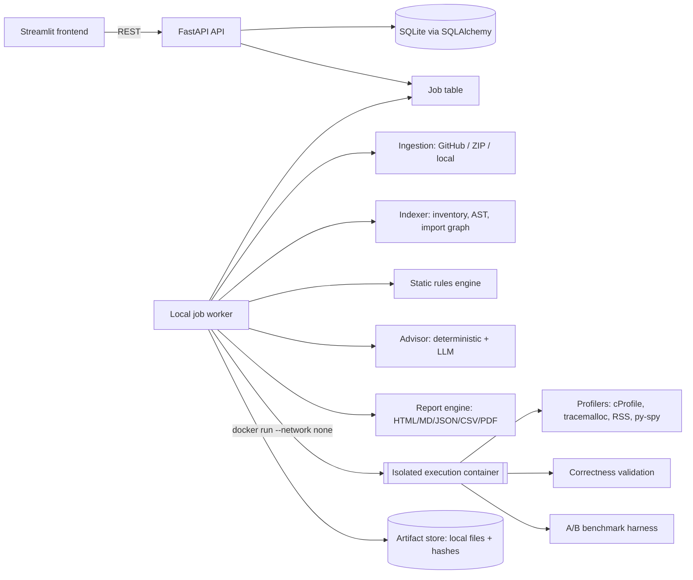

# PerfPilot AI — Implementation Plan

This is the working plan and checklist for building PerfPilot AI. It is updated as work lands: a box
is only ticked after the work is merged to `main` **and** verified by tests or a recorded run.

- Branching, commit, and merge rules: [docs/development-workflow.md](docs/development-workflow.md)
- Architecture decisions taken during planning: [docs/decisions.md](docs/decisions.md)

---

## 1. Product framing

**Repository Audit is the primary entry point.** Workload optimization is the deeper workflow
underneath it.

```
Repository (GitHub URL / ZIP / allowlisted local dir)
   └─► Static Audit (default, never executes code)
         ├─ inventory, AST index, dependency graph
         ├─ deterministic findings (hypotheses with file:line evidence)
         ├─ hierarchical AI summary + prioritized recommendations (optional LLM)
         └─ report (HTML / Markdown / JSON / PDF)
   └─► Runtime Audit (opt-in, explicit approval, isolated container only)
         ├─ discover test/benchmark commands → user approves one
         ├─ CPU + memory profiling → correlate hotspots with static findings
         └─ pick hotspot ─► Workload Optimization (deep dive)
               profile → recommend → patch → approve → validate → A/B benchmark → report
```

The guiding rule throughout: **nothing that sounds like an optimization counts until it is
profiled, validated, and benchmarked.** Every result carries one of three provenance labels:

| Label | Meaning | Example |
|---|---|---|
| `MEASURED` | Produced by running code in this environment | median 182.4 ms over 20 runs |
| `STATIC` | Deterministic AST/rule output, no execution | `PP-LOOP-001` list membership in loop at `app/x.py:42` |
| `AI_HYPOTHESIS` | LLM- or heuristic-generated, unverified | "likely O(n²) → O(n) with an index" |

The UI mockups shared during planning are used **only for visual direction** (sidebar navigation, card
layout, side-by-side diffs, before/after charts). Their numbers are illustrative. PerfPilot never shows a
metric it did not compute.

---

## 2. Target architecture



Key boundaries:

- The **API never runs repository code** and never shells out with user input. It validates input,
  persists records, and enqueues jobs.
- The **worker** handles ingestion and static analysis itself. Static analysis only parses code; it
  never imports or executes it.
- **Untrusted code** (any imported repository) runs only inside the **sandbox container**: no network,
  CPU/memory/pid/time limits, non-root user, read-only source mount, and a writable tmp output.
- **Bundled trusted workloads** (the `examples/` folder) may run in a constrained subprocess, as the
  base spec allows, so the deep-dive workflow is demoable without Docker.
- The **LLM layer has no tools**. It receives curated, redacted context and returns Pydantic-validated
  JSON whose file/line citations are checked against the index before they are accepted.

---

## 3. Repository layout (target)

The base spec's layout is kept. These packages are added for the audit feature:

```
backend/
  ingestion/            # providers + secure extraction + limits + filtering + git metadata
    providers/{base,github_public,github_private,zip_upload,local_dir}.py
    extraction.py  filters.py  limits.py  git_meta.py  detection.py  dependencies.py  redaction.py
  indexing/             # inventory, AST parsing, symbol table, import/module graph
    inventory.py  ast_index.py  import_graph.py  call_graph.py  complexity.py
  audit/                # repository-level orchestration
    rules/              # one module per rule family (loops, collections, async, io, db, alloc, cache)
    rule_engine.py  findings.py  path_ranking.py  correlation.py  orchestrator.py
  ai/                   # advisor, hierarchical summarizer, context retrieval, token budget
    prompts/  llm_client.py  deterministic_advisor.py  summarizer.py  retrieval.py
    budget.py  citation_guard.py
  sandbox/              # isolated execution backend (docker) + command discovery + approvals
    backend.py  docker_backend.py  command_discovery.py  approvals.py
  reporting/
    templates/  html.py  markdown.py  json_export.py  csv_export.py  pdf.py
frontend/pages/
  1_repository_audit.py   # PRIMARY: landing page
  2_findings.py  3_dependency_graph.py  4_runtime_audit.py
  5_workload_explorer.py  6_profiling.py  7_recommendations.py  8_optimization.py
  9_benchmarks.py  10_reports.py
tests/fixtures/repos/     # small, deterministic Python repos used for audit tests
```

---

## 4. Phases, branches, and checklists

Each phase gets its own branch off `main` and is merged back with `--no-ff` once its **exit criteria**
pass. Large phases may be split into several branches (listed per phase). Phases are ordered so that
every merge leaves `main` runnable.

### Phase 0 — Planning · `docs/implementation-plan`
- [x] Read and reconcile the base spec and the Repository Audit feature spec
- [x] Write this plan, the decisions log, and the development workflow
- [ ] Merge to `main`

### Phase 1 — Foundation · `feature/foundation`
- [ ] `pyproject.toml` managed by `uv`, Python 3.12, committed `uv.lock`
- [ ] Ruff, mypy (strict on `backend/`), pre-commit, Makefile targets
- [ ] `core/config.py` (pydantic-settings; `.env.example`), `core/logging.py` (structured JSON logs, secret scrubbing), `core/exceptions.py`
- [ ] SQLAlchemy 2.x models + Alembic baseline migration, UUID PKs, timestamps, status + error fields
- [ ] Repository abstraction (`infrastructure/repository.py`) and artifact store (path + sha256 + metadata)
- [ ] Job system: `Job` table, states `QUEUED/RUNNING/SUCCEEDED/FAILED/CANCELLED/TIMED_OUT`, idempotency key, lease/heartbeat, persistent local worker process (`python -m backend.infrastructure.worker`)
- [ ] FastAPI app: `GET /api/health`, `GET /api/jobs/{id}`, `GET /api/projects`, error envelope, OpenAPI
- [ ] Streamlit shell: sidebar nav, theme/CSS, API client, empty states that show real DB data only
- [ ] CI v1 (`.github/workflows/ci.yml`): ruff, mypy, pytest
- **Exit:** `make dev` starts API, worker, and UI; health check is green; a test job is enqueued, run by the worker, and survives restart.

### Phase 2 — Repository ingestion · `feature/repo-ingestion`
- [ ] `RepositoryProvider` protocol: `resolve(ref) -> AcquiredSource` with typed `RepositoryRef`
- [ ] `PublicGitHubProvider`: URL validation (only `https://github.com/<owner>/<repo>[/tree/<ref>]`), shallow `git clone --depth 1 --no-tags --filter=blob:limit=…`, `GIT_TERMINAL_PROMPT=0`, hooks disabled, `protocol.allow` restricted to https, timeout
- [ ] `ZipUploadProvider`: streaming upload size cap; safe extraction (reject absolute paths, `..`, drive letters, symlinks/hardlinks, device files; cap entries, total uncompressed bytes, and compression ratio to stop zip bombs)
- [ ] `LocalDirectoryProvider`: only paths under `PERFPILOT_LOCAL_ALLOWLIST`, resolved with `realpath`; copied (not mounted) into the workspace, without following symlinks out of the root
- [ ] `PrivateGitHubProvider` **interface only + documented design**: GitHub App / OAuth device flow, short-lived installation tokens passed through `GIT_ASKPASS`/HTTP header, never in URLs or logs. Raises `NotConfigured` until implemented.
- [ ] Workspace manager: per-audit temp dir under `data/workspaces/<id>`, read-only after ingest, cleanup policy
- [ ] Limits: max files, max total bytes, max single-file bytes, max Python files parsed, clone/extract timeouts (all configurable, enforced with clear errors)
- [ ] Filters: `.git`, venvs (`.venv`, `venv`, `site-packages`, `pyvenv.cfg` detection), `node_modules`, `build/`, `dist/`, `__pycache__`, generated markers (`# Generated by`, `_pb2.py`, migrations opt-in), binaries (NUL-byte sniff + extension list), large data files
- [ ] Git metadata: commit SHA, branch/ref, remote URL (credentials stripped), commit date, dirty flag
- [ ] Language and framework detection (by extension + manifest + import evidence: Django, Flask, FastAPI, SQLAlchemy, pandas, NumPy, asyncio, Celery, …), each with the evidence that triggered it
- [ ] Dependency discovery: `pyproject.toml` (PEP 621, Poetry), `requirements*.txt`, `setup.cfg`, `setup.py` (AST read only, never executed), `Pipfile`, lock files
- [ ] Secret redaction module (regex + entropy: AWS/GCP/Azure keys, GitHub tokens, private keys, `.env` values, connection strings), used before **any** external AI call and in reports
- [ ] API: `POST /api/repositories` (GitHub URL / local), `POST /api/repositories/upload` (ZIP), `GET /api/repositories/{id}`, `GET /api/repositories/{id}/files`
- [ ] Tests: zip-slip, symlink escape, zip bomb, oversized repo, bad URLs (ssh, file://, other hosts, credentials in URL), allowlist escape, redaction corpus
- **Exit:** a fixture repo imported through all three providers yields an identical inventory, and every security test passes.

### Phase 3 — Indexing and static audit · `feature/code-indexing`, then `feature/static-audit-rules`
**`feature/code-indexing`**
- [ ] Parse every eligible `.py` file with `ast` (per-file errors recorded, not fatal); store module records, symbols (functions, classes, methods, async flag, decorators, line spans), and docstrings
- [ ] Module resolution (package roots, `src/` layout, relative imports) → import graph (internal edges and external dependencies); cycle detection; fan-in/fan-out
- [ ] Lightweight intra-repo call graph (name-based, labeled best-effort)
- [ ] Entry-point detection: `__main__`, console scripts, FastAPI/Flask/Django routes, Celery tasks, CLI (click/typer/argparse)
- **Exit:** the index and graph are persisted, and `GET /api/repositories/{id}/graph` returns nodes and edges.

**`feature/static-audit-rules`** — deterministic rules. Each finding has rule ID, title, description, `file:line-range`, snippet, suggestion, confidence, semantic trade-offs, and provenance `STATIC`.
- [ ] Base spec rules: list membership in loop, string `+=` in loop, nested-loop lookup/join, regex compile in loop, repeated pure call with unchanged args, dict/set lookup opportunities
- [ ] Algorithmic: nested loops over the same/related iterables (with depth), `list.index`/`.count`/`in` inside loops, sort inside loop, `pop(0)` / `insert(0, …)` on lists
- [ ] Repeated data processing: identical comprehension/transform recomputed in a loop or across sibling calls; repeated `json.loads`/`pd.read_*` of the same source
- [ ] Inefficient collections: list used as queue (`deque`), repeated `list(dict.keys())`, `len(list(...))`
- [ ] Repeated DB queries: ORM/DB-API calls inside loops (N+1 pattern) for SQLAlchemy, Django ORM, sqlite3, psycopg
- [ ] Allocations: objects/large literals built inside hot loops, `copy.deepcopy` in loops, string formatting in tight loops
- [ ] Async blocking: `time.sleep`, `requests.*`, sync file I/O, `subprocess.run`, sync DB drivers inside `async def`
- [ ] Repeated network calls: HTTP clients inside loops; a new `requests.Session` / `httpx.Client` per call
- [ ] Caching opportunities: pure functions called repeatedly with literal/constant args; no `lru_cache` on recursive pure functions
- [ ] Architectural: import-time heavy work, chatty module boundaries (high-fan-in hot modules), global mutable caches without bounds
- [ ] Complexity estimate per function (loop nesting, recursion), labeled as an estimate
- [ ] Prioritization score = severity × confidence × path-criticality (entry-point reachability, fan-in), with the formula documented
- [ ] Positive **and** false-positive unit tests per rule
- **Exit:** the audit on the fixture repo yields the expected finding set, and every `file:line` resolves to real source.

### Phase 4 — AI-assisted architecture analysis · `feature/ai-advisor`
- [ ] `DeterministicAdvisor`: maps findings → recommendations with no LLM (the default path)
- [ ] OpenAI-compatible `LLMClient` (httpx), env-configured base URL/model/key, timeouts, bounded retries, token/cost accounting, optional local-model adapter (e.g. Ollama via its OpenAI-compatible endpoint)
- [ ] Hierarchical pipeline: (1) function/module summaries for *relevant* units only → (2) dependency context → (3) candidate hot paths → (4) cross-module correlation → (5) prioritized recommendations
- [ ] Selective retrieval: snippets chosen by finding location + graph neighborhood, never the whole repo
- [ ] Token budget manager: per-stage and per-audit caps; deterministic truncation; budget-exhaustion reported, not hidden
- [ ] Structured output via Pydantic (`OptimizationRecommendation` per base spec + `ArchitectureInsight`); malformed output → bounded retry → fall back to deterministic
- [ ] **Citation guard:** every file/line/symbol the model cites must exist in the index; invalid citations are dropped and counted; the model may not emit numeric runtime metrics (schema forbids; validator rejects)
- [ ] Redaction applied before sending; UI banner + explicit opt-in before any snippet leaves the machine
- [ ] Prompt files in `backend/ai/prompts/`, versioned
- [ ] Evals: 20–30 scenarios in `evals/` (mocked LLM in CI, real model optional)
- **Exit:** a full audit completes with no API key; with a mocked LLM, recommendations pass the citation guard.

### Phase 5 — Workload profiling engine · `feature/profiling`
- [ ] `WorkloadSpec` (base spec §6), entrypoint resolved inside the registered workspace
- [ ] Five bundled workloads in `examples/`: list_lookup, duplicate_counter, string_builder, regex_matching, nested_loop, each with fixtures, tests, a benchmark config, and an explanation
- [ ] Subprocess runner: fixed interpreter, arg list (no `shell=True`), timeout, `resource` rlimits, scrubbed env, temp cwd
- [ ] cProfile → pstats → normalized `Hotspot` rows (exclusive% vs cumulative% documented and never summed)
- [ ] tracemalloc peak vs psutil RSS, labeled separately; unsupported → `unavailable`
- [ ] Optional py-spy (flamegraph/speedscope) with graceful degradation
- [ ] Profiling UI pages (workload explorer, hotspots, memory)
- **Exit:** profiling a bundled workload from the UI and from the CLI gives persisted, non-hardcoded metrics.

### Phase 6 — Patch and correctness validation · `feature/patch-validation`
- [ ] Lifecycle state machine (base spec §17) with transition guards + tests
- [ ] Patch generation (deterministic templates for bundled rules + LLM when configured) against a hashed source snapshot
- [ ] Patch validator: unified-diff parse, allowed-file list, deny secrets/CI/security config/benchmark harness/tests, path containment
- [ ] Explicit approval endpoint; patched copy in an isolated workspace; original tree hash verified unchanged
- [ ] Validation engine: unit tests, acceptance fixtures, output comparison with tolerances, exception parity, input-mutation detection; `PASSED/FAILED/INCONCLUSIVE/NOT_RUN`
- [ ] Diff UI (side-by-side + unified), approve/reject, rejection reasons
- **Exit:** three workloads produce reviewable patches; invalid patches are rejected; a failed validation blocks benchmarking.

### Phase 7 — Benchmark engine · `feature/benchmarking`
- [ ] Paired A/B harness: fresh processes, warmups (default 5), measured runs (default 20), randomized/alternating order
- [ ] Raw sample storage; median/mean/min/max/stdev/p95; bootstrap CI on the speedup ratio
- [ ] Formulas from base spec §12.3 with unit tests (including the 200 ms → 125 ms = 1.6× / 37.5% example)
- [ ] Regression classifier: `IMPROVED/REGRESSED/NO_CLEAR_DIFFERENCE/INCONCLUSIVE/INVALID` with a configurable practical threshold
- [ ] Environment fingerprint (OS, arch, CPU, Python, lock hash, source hash, settings)
- [ ] Benchmark UI: distributions (box/strip), speedup with CI, memory comparison, warnings
- [ ] At least one workload demonstrably shows *no benefit or regression*
- **Exit:** real A/B runs are persisted, and the formulas are verified by tests.

### Phase 8 — Runtime Repository Audit · `feature/sandbox-runtime`, then `feature/runtime-audit`
**`feature/sandbox-runtime`**
- [ ] `ExecutionBackend` protocol; `DockerSandboxBackend`: `--network none`, `--read-only`, tmpfs `/tmp`, `--cpus`, `--memory`, `--pids-limit`, `--cap-drop ALL`, `--security-opt no-new-privileges`, non-root UID, wall-clock kill
- [ ] Sandbox image with profilers preinstalled; dependency install happens in a separate, explicitly approved network-enabled step that produces a cached env layer, then runs offline
- [ ] The worker talks to Docker; **the API container gets no Docker socket**
- [ ] If no isolation backend is available, runtime mode is **disabled with a clear reason**. It never falls back to the host.

**`feature/runtime-audit`**
- [ ] Command discovery: pytest/unittest, `pytest-benchmark`, `asv`, `tox`/`nox` envs, Makefile targets, `[project.scripts]`. Each is a proposal with provenance, never auto-run.
- [ ] Approval record (who, when, exact argv, image, limits) required before execution
- [ ] Profile approved command in the sandbox (cProfile + tracemalloc + RSS); map hotspots → indexed symbols
- [ ] Correlation: findings with a matching runtime hotspot get upgraded with `MEASURED` evidence; static-only findings stay `STATIC`
- [ ] Hotspot → deep-dive: generate a candidate patch → validate (repo tests in sandbox) → A/B benchmark with an identical workload
- **Exit:** on a trusted fixture, an approved workload yields measured hotspots that are correlated to findings.

### Phase 9 — Reporting · `feature/reporting`
- [ ] Single `AuditReport` model rendered to HTML (Jinja2), Markdown, JSON, CSV (findings/samples), PDF
- [ ] Sections 1–15 from the feature spec; each metric carries its provenance badge; empty sections say "not measured" instead of being omitted or invented
- [ ] Embedded dependency-graph image and charts (Plotly → static SVG via kaleido)
- [ ] Reproducibility block: commit SHA, PerfPilot version, config, exact commands, environment fingerprint
- [ ] Secret-redaction pass + test that no secret from a fixture leaks into any format
- **Exit:** reports in all formats are generated from the fixture audit and are contract-tested.

### Phase 10 — Frontend: Repository Audit primary · `feature/frontend-audit`
- [ ] Landing page = **Repository Audit**: GitHub URL input, ZIP upload, (local dir if allowlisted), mode selector (Static default; Runtime gated)
- [ ] Job progress with stage-by-stage status (polling `GET /api/jobs/{id}`)
- [ ] Repository summary (metadata, languages, frameworks, dependencies, limits hit) and file explorer with per-file finding counts
- [ ] Findings table with severity/rule/provenance/module filters; source viewer with highlighted lines; GitHub permalink at the exact commit SHA
- [ ] Module dependency graph (Plotly + networkx layout; hot modules highlighted; cycles marked)
- [ ] AI recommendations panel (clearly labeled hypotheses), external-AI consent toggle
- [ ] Runtime audit panel: discovered commands → approve → results
- [ ] Export buttons (HTML, MD, JSON, PDF)
- [ ] Deep-dive pages from Phases 5–7 linked from a hotspot ("Optimize this")
- **Exit:** a user can audit a public repo end to end in the UI without an LLM key.

### Phase 11 — Hardening · `chore/hardening`
- [ ] Security review of ingestion, sandbox, and patch paths; `tests/security/` complete
- [ ] Observability: structured logs with job/project/run IDs, durations, token/cost; optional OpenTelemetry spans
- [ ] Docker: `Dockerfile` (api/worker/ui), `docker-compose.yml` with volumes; separate sandbox image; non-root
- [ ] `security.yml`: pip-audit, gitleaks, CodeQL (or bandit)
- [ ] CI: coverage gate (≥80% on core logic), Docker build validation, no benchmarking on shared runners
- [ ] Docs: `architecture.md`, `methodology.md`, `security.md`, `ai-design.md`, `api.md`, `limitations.md`

### Phase 12 — End-to-end acceptance and demo · `test/e2e-acceptance`, then `docs/portfolio`
- [ ] E2E test (feature spec acceptance 1–11) against `tests/fixtures/repos/<fixture>`:
  import → index → graph → static audit → findings with valid refs → HTML+PDF → assert no `MEASURED` values present → select trusted workload → approve → sandbox profile → report with measured data
- [ ] Optional network-marked variant against a real small public repo
- [ ] Base-spec E2E (§24) for the duplicate-counter and one other workload, including restart persistence
- [ ] Real screenshots, real benchmark table, evaluation report from measured results
- [ ] README polish

---

## 5. Data model additions (audit feature)

`Repository`, `RepositorySnapshot` (commit SHA, ref, source type, hashes, limits applied),
`SourceFile` (path, size, sha256, language, skipped reason), `Module`, `Symbol`, `ImportEdge`,
`AuditRun` (mode, status, stage, budget usage), `Finding` (rule, location, snippet hash, severity,
confidence, provenance, priority), `ArchitectureInsight`, `RuntimeCommand` (discovered argv,
source), `RuntimeApproval`, `RuntimeProfile` → reuses `ProfileRun`/`Hotspot`, `HotspotCorrelation`,
`Report` (format, artifact ref). These are combined with the base-spec tables (Project, Workload,
SourceSnapshot, ProfileRun, Hotspot, AnalysisRun, OptimizationRecommendation, OptimizationCandidate,
ValidationRun, BenchmarkRun, BenchmarkSample, Artifact, Job).

## 6. API additions (audit feature)

| Method | Path | Purpose |
|---|---|---|
| POST | `/api/repositories` | Import from GitHub URL or allowlisted local path → job |
| POST | `/api/repositories/upload` | Import ZIP (multipart) → job |
| GET | `/api/repositories/{id}` | Metadata, detection, dependencies |
| GET | `/api/repositories/{id}/files` | Inventory (+ skipped files and reasons) |
| GET | `/api/repositories/{id}/files/content?path=` | Source text (path-validated) |
| GET | `/api/repositories/{id}/graph` | Module dependency graph |
| POST | `/api/audits` | Start static audit (optionally with LLM consent) → job |
| GET | `/api/audits/{id}` | Status, stages, summary |
| GET | `/api/audits/{id}/findings` | Filterable findings |
| GET | `/api/audits/{id}/recommendations` | Prioritized recommendations |
| GET | `/api/audits/{id}/runtime/commands` | Discovered candidate commands |
| POST | `/api/audits/{id}/runtime/approvals` | Approve exact command + limits → job |
| GET | `/api/audits/{id}/runtime` | Runtime profile + correlations |
| POST | `/api/audits/{id}/reports` | Generate report in a format → job |
| GET | `/api/reports/{id}` / `/download` | Report metadata / file |

The base-spec endpoints (projects, profiles, analyses, optimizations, benchmarks, jobs) are
implemented as listed in that spec.

## 7. Testing strategy (summary)

| Level | Focus |
|---|---|
| Unit | rules (positive + negative), extraction safety, filters, redaction, graph building, formulas, state machine, citation guard |
| Integration | ingest → index → audit → report on fixture repos; workload profile → patch → validate → benchmark |
| API | status codes, validation errors, unknown IDs, job lifecycle, idempotency |
| Security | zip-slip, symlinks, zip bombs, URL abuse, allowlist escape, disallowed patch paths, secrets in reports, no shell injection |
| E2E | acceptance scenario (Phase 12), marked `docker` where the sandbox is needed |
| Performance | startup, report generation, non-benchmark API latency; smoke-only, non-authoritative |

The LLM is always mocked in CI. Tests needing Docker or network are marked and skipped with a stated reason when
those are unavailable; they are never silently passed.

## 8. Environment prerequisites (current machine)

| Tool | Status | Needed for |
|---|---|---|
| Python 3.12 | ✅ 3.12.10 present | runtime (3.13 also present) |
| git | ✅ | ingestion, workflow |
| uv | ❌ missing → `brew install uv` | dependency management/lockfile |
| Docker Desktop | ❌ missing | runtime audit sandbox, `docker compose`, E2E steps 9–11 |
| Pango (for WeasyPrint PDF) | to verify → `brew install pango` | PDF reports (bundled in Docker image) |

Until Docker is installed, phases 1–7, 9, and 10 can be fully built and tested. Phase 8 and E2E steps 9–11 will
be implemented, but runtime mode will report `isolation backend unavailable` locally.

## 9. Risks and mitigations

| Risk | Mitigation |
|---|---|
| Executing untrusted code | Sandbox-only for imported repos; no host fallback; approvals logged |
| Static false positives | Positive/negative tests per rule; confidence levels; `STATIC` label; never claimed as measured |
| LLM hallucinated files/lines/metrics | Citation guard + schema forbids numeric runtime claims + deterministic fallback |
| Token cost on large repos | Hierarchical summarization, selective retrieval, hard budgets, caching by file hash |
| Benchmark noise | Paired runs, warmups, bootstrap CI, practical threshold, environment fingerprint |
| PDF system deps | WeasyPrint in Docker image; documented local install; PDF test skipped with reason if unavailable |
| Huge repositories | File/byte/parse limits with partial-audit reporting ("analyzed N of M files") |

## 10. Progress log

| Date | Branch | Summary |
|---|---|---|
| 2026-10-20 | `main` | Repository initialized |
| 2026-10-20 | `docs/implementation-plan` | Implementation plan, decisions log, and development workflow |
