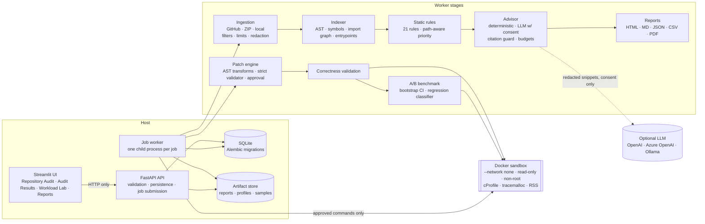

# PerfPilot AI

> **AI-powered code optimization backed by real profiling and reproducible benchmarks.**

[](https://github.com/rosanne-odiero/perfpilot-ai/actions/workflows/ci.yml)
[](https://github.com/rosanne-odiero/perfpilot-ai/actions/workflows/security.yml)


PerfPilot AI audits a whole Python repository for performance risks. Then it lets you take any
hotspot further: profile it, generate a safe optimization, prove the behavior did not change,
and benchmark whether it is actually faster.

Most AI coding assistants can *say* code might be faster. PerfPilot separates an optimization that
**sounds good** from one that is **verified**. Every number and claim is labeled:

| Label | Meaning |
|---|---|
| `MEASURED` | Produced by running code (profiler, benchmark) in an isolated environment |
| `STATIC` | Deterministic AST / rule analysis. No code was executed |
| `AI_HYPOTHESIS` | LLM- or heuristic-generated suggestion. Unverified until measured |

**No API key is required.** Without an LLM, a deterministic advisor produces the recommendations.
With an LLM configured (OpenAI, Azure OpenAI, or a local Ollama), you get richer analysis, but
only after you explicitly consent, and only redacted snippets are sent.

---

## Contents

- [What it does](#what-it-does)
- [Quick start (step by step)](#quick-start-step-by-step)
- [Audit your own repository](#audit-your-own-repository)
- [Connect your LLM (optional)](#connect-your-llm-optional)
- [Runtime audit: measure real hotspots (optional, Docker)](#runtime-audit-measure-real-hotspots-optional-docker)
- [Run everything with Docker Compose](#run-everything-with-docker-compose)
- [Measured results](#measured-results)
- [Architecture](#architecture)
- [Engineering decisions](#engineering-decisions)
- [Development](#development)
- [Limitations](#limitations)
- [Documentation](#documentation)
- [Future improvements](#future-improvements)

---

## What it does

```
Your repository  (public GitHub URL · ZIP upload · allowlisted local folder)
  │
  ├─► Static Audit (default, never executes code)
  │     inventory → AST index → module dependency graph → 21 performance rules
  │     → findings with exact file:line evidence, prioritized by execution path
  │     → recommendations (deterministic, or LLM with consent) → HTML / MD / JSON / CSV / PDF report
  │
  └─► Runtime Audit (opt-in, explicit approval, Docker sandbox only)
        discover test/benchmark commands → you approve one exact command
        → CPU + memory profile in a no-network, resource-limited container
        → hotspots correlated with static findings (MEASURED evidence)
        → "Optimize this": patch → approve → validate (repo tests) → paired A/B benchmark
```

The **Workload Lab** is the same deep dive on five bundled, trusted example workloads. You can use
it to see the full loop without importing anything.

**Static rules** cover:
- algorithmic inefficiencies and expensive nested loops;
- list membership tests inside loops, repeated `count`/`index`/`pop(0)` calls;
- repeated data processing and sorting inside loops;
- N+1 database queries (SQLAlchemy, Django ORM, DB-API);
- blocking calls inside `async def`;
- repeated network calls and HTTP clients created per call;
- allocation-heavy loops, string `+=` building, regex compiled in loops;
- caching opportunities, and heavy work at import time.

Every finding is a hypothesis with evidence and stated trade-offs. None is presented as a
measurement.

---

## Quick start (step by step)

These steps take about 5 minutes on a typical laptop and need no API key.

### 1. Install the prerequisites

| Tool | Why | Install |
|---|---|---|
| **git** | clone the repo; import GitHub repositories | <https://git-scm.com> |
| **Python 3.11–3.13** | runtime | <https://www.python.org/downloads/> (3.12 recommended) |
| **uv** | installs the exact locked dependencies | `curl -LsSf https://astral.sh/uv/install.sh \| sh` (macOS/Linux) · `powershell -c "irm https://astral.sh/uv/install.ps1 \| iex"` (Windows) |
| **make** *(optional)* | short commands below | preinstalled on macOS/Linux; on Windows run the commands shown after each `make` target |
| **Docker Desktop** *(optional)* | Runtime Audits and `docker compose` | <https://www.docker.com/products/docker-desktop/> |

### 2. Clone and install

```bash
git clone https://github.com/rosanne-odiero/perfpilot-ai.git
cd perfpilot-ai
uv sync --all-extras          # creates .venv with the exact versions from uv.lock
cp .env.example .env          # optional: every setting has a safe default
```

### 3. Start PerfPilot

```bash
make dev
```

`make dev` starts three processes. Press `Ctrl+C` to stop them all. Without `make`, run each
command in its own terminal:

```bash
uv run uvicorn backend.main:app --port 8000               # API      → http://127.0.0.1:8000/docs
uv run python -m backend.jobs.worker                      # job worker (runs audits, profiles, reports)
uv run streamlit run frontend/app.py --server.port 8501   # UI       → http://127.0.0.1:8501
```

### 4. Run your first audit

1. Open **<http://127.0.0.1:8501>**. The landing page is **Repository Audit**.
2. Paste a public GitHub URL, for example `https://github.com/pallets/itsdangerous`, and keep
   **Static Audit** selected.
3. Click **Start audit**. You'll see the import, indexing, graph, rules and recommendations
   stages complete one by one.
4. Open **Audit Results** to see:
   - the summary;
   - a file explorer with highlighted finding lines;
   - filterable findings, each with a "View on GitHub" link pinned to the audited commit;
   - the module dependency graph;
   - recommendations.
5. In the **Export** tab, download the report as HTML, Markdown, JSON, CSV or PDF.

Prefer the command line? The same flow, as the UI drives it, is one script. The reports and a
`summary.json` are written to the output folder:

```bash
uv run python scripts/evaluate_repository.py \
  --github https://github.com/pallets/itsdangerous --out data/evaluations/itsdangerous
```

---

## Audit your own repository

You have three options. Each is a tab on the Repository Audit page.

**A. Public GitHub repository.** Paste `https://github.com/<owner>/<repo>`. To pin a branch, tag
or commit, fill in the optional **Branch, tag or commit** field, or paste a `…/tree/<ref>` URL.
- PerfPilot makes a shallow clone with hooks disabled.
- Only `https://github.com` URLs are accepted, and URLs with embedded credentials are rejected.
- Private repositories aren't supported yet; [docs/private-github.md](docs/private-github.md)
  describes the planned GitHub App / OAuth flow. Until then, use B or C.

**B. ZIP upload.** Zip your project, or download it from GitHub with *Code → Download ZIP*, and
upload it (100 MB limit by default).
- Archives are extracted safely: path traversal, symlinks, device files and zip bombs are
  rejected.

**C. A folder on this machine.** For safety, local folders must be **allowlisted** first. Add the
parent folder to `.env` and restart the API and worker:

```bash
# .env
PERFPILOT_LOCAL_ALLOWLIST=~/code,~/Developer        # comma-separated; nothing outside is readable
```

Then choose **Local directory** and enter the absolute path, for example
`/Users/me/code/my-service`. Or use the CLI, which allowlists the folder for you:

```bash
uv run python scripts/evaluate_repository.py --local ~/code/my-service --out data/evaluations/my-service
```

**What gets analyzed:**
- Python sources are indexed.
- Virtualenvs, `node_modules`, build output, caches, binaries and generated files are skipped,
  each with a recorded reason.
- Secrets files (`.env`, keys, credentials) are never read, shown, hashed or sent anywhere.
- Large repositories hit configurable limits (`PERFPILOT_MAX_*`). The audit then completes as
  `PARTIAL` and says exactly what was not analyzed.

**Private code stays private:**
- A static audit runs entirely on your machine.
- Reports mention only the folder name, never your local path.
- `--anonymize` on the evaluation script produces a summary without paths, symbols or snippets.

---

## Connect your LLM (optional)

PerfPilot works fully without an LLM. To add richer, hierarchical analysis (function and module
summaries, likely hot paths, cross-module correlation, prioritized recommendations) and LLM patch
proposals:

**1. Configure an OpenAI-compatible endpoint in `.env`.** It must be in `.env` (or the
environment) of **both the API and the worker**.

```bash
# OpenAI
PERFPILOT_LLM_BASE_URL=https://api.openai.com/v1
PERFPILOT_LLM_MODEL=gpt-4o-mini
PERFPILOT_LLM_API_KEY=sk-...

# Azure OpenAI (v1-compatible endpoint; the model is your deployment name)
# PERFPILOT_LLM_BASE_URL=https://<resource>.openai.azure.com/openai/v1
# PERFPILOT_LLM_MODEL=<deployment-name>
# PERFPILOT_LLM_API_KEY=<key>

# Ollama or LM Studio (local, no key, nothing leaves your machine)
# PERFPILOT_LLM_BASE_URL=http://localhost:11434/v1
# PERFPILOT_LLM_MODEL=qwen2.5-coder:7b

# Optional: token budget per audit and cost accounting (USD per 1K tokens)
# PERFPILOT_LLM_MAX_TOKENS_PER_AUDIT=60000
# PERFPILOT_LLM_INPUT_COST_PER_1K=0.00015
# PERFPILOT_LLM_OUTPUT_COST_PER_1K=0.0006
```

**2. Restart** (`Ctrl+C`, then `make dev`). **System Status** now shows the model name.

**3. Turn on "Use AI"** on the Repository Audit page and tick the consent checkbox. The banner
lists exactly what will be sent: function snippets around findings, after secret redaction.
- CLI equivalent: `scripts/evaluate_repository.py ... --use-llm`.
- API equivalent: `"use_llm": true, "llm_consent": true`.

**Guardrails:**
- **Redaction:** secrets are redacted before anything leaves the machine.
- **Citation guard:** model output must cite real files, lines and symbols, or it is dropped.
- **No invented numbers:** claims of runtime numbers are stripped, because the model never ran
  the code.
- **Budgets:** token budgets are enforced, and usage and cost are shown per audit.
- **Fallback:** malformed output falls back to the deterministic advisor.
- **Labeling:** model output is always labeled `AI_HYPOTHESIS`.

Details: [docs/ai-design.md](docs/ai-design.md).

---

## Runtime audit: measure real hotspots (optional, Docker)

Static findings are hypotheses. A **Runtime Audit** measures them by running a command **you
approve** in a hardened Docker container:
- no network;
- read-only source and read-only filesystem;
- CPU, memory, PID and time limits;
- non-root user with all capabilities dropped.

Untrusted code never runs on your host, and there is no fallback that would run it there.

```bash
# once: install Docker Desktop and start it, then build the sandbox image
make sandbox-image        # = docker build -f docker/sandbox.Dockerfile -t perfpilot-sandbox:latest docker
```

1. On Repository Audit, choose **Runtime Audit** and start. The static audit runs, then PerfPilot
   **discovers** candidate commands without running them: pytest suites, pytest-benchmark,
   `benchmarks/*.py` scripts and console scripts.
2. In **Audit Results → Runtime**, review a command and approve it. The approval pins the exact
   argv, image and limits.
   - If your tests need third-party packages, tick **Install dependencies**. This is a separate,
     explicitly approved step: wheels only, the only step with network access, and installed into
     a per-snapshot folder.
3. The worker profiles the command in the sandbox:
   - CPU hotspots;
   - Python-traced memory (tracemalloc) and process RSS, reported separately.

   Hotspots are mapped to source symbols, and matching findings gain **MEASURED** evidence and are
   re-ranked.
4. On a measured finding, click **Optimize this**:
   1. PerfPilot proposes a patch. It uses a deterministic AST transform, or your LLM if consented.
   2. You **approve** the diff.
   3. Your approved test command runs on the original and patched copies, and must show no
      regressions.
   4. A **paired A/B benchmark** runs: fresh containers, randomized order, identical inputs and a
      bootstrap confidence interval.

   The result is classified `IMPROVED`, `REGRESSED`, `NO_CLEAR_DIFFERENCE` or `INCONCLUSIVE`.

The CLI equivalent of steps 1–3:

```bash
uv run python scripts/evaluate_repository.py --local ./my-repo --mode RUNTIME \
  --approve "python -m pytest -q" --allow-dependency-install --out data/evaluations/my-repo-runtime
```

See [docs/runtime-audit.md](docs/runtime-audit.md), [docs/sandbox.md](docs/sandbox.md) and
[docs/repo-optimization.md](docs/repo-optimization.md).

---

## Run everything with Docker Compose

```bash
make sandbox-image                                # sandbox for runtime audits (optional)
make compose-up                                   # builds and starts api + worker + ui; data persists in ./data
open http://127.0.0.1:8501                        # UI (API docs: http://127.0.0.1:8000/docs)
PERFPILOT_IMPORT_DIR=$HOME/code make compose-up   # also mount ~/code read-only for local imports
make compose-down                                 # stop (data is kept)
```

- Only the **worker** gets the Docker socket; the API and UI never do.
- Ports bind to `127.0.0.1` because the API has no authentication. It is a local, single-user tool.
- See [docs/deployment.md](docs/deployment.md) for the socket trade-off, why data is mounted at the
  same absolute path, and how to use a package mirror behind a proxy.

---

## Measured results

All numbers below were **measured** by PerfPilot's own pipeline. Each row is a full run of the
workload deep dive:
- profile, then a deterministic recommendation;
- a **patch generated by PerfPilot** from the original source, then explicit approval;
- correctness validation (8/8 required checks: unit tests, multi-seed output comparison, edge
  cases, exception parity, input mutation);
- a paired benchmark: 5 warmups, 20 measured pairs per variant, each in a fresh process,
  randomized order, 95% bootstrap CI on the speedup of medians, 5% practical-significance
  threshold.

Environment: Apple M4 Pro, macOS 26.7, CPython 3.12.10, medium input size, captured 2026-10-20
on a desktop with other work running (load average about 3). Reproduce with
`uv run python scripts/optimize_workload.py <workload> --approve`. Your numbers will differ.

| Workload | Patch (generated by PerfPilot) | Validation | Baseline median | Optimized median | Speedup (95% CI) | Latency change | tracemalloc peak | Result |
|---|---|---|---|---|---|---|---|---|
| `duplicate_counter` | `list.count` in loop → `collections.Counter` | PASSED | 96.28 ms | 0.306 ms | 314.3× (312.0–316.6) | −99.7% | 19.3 KB → 48.2 KB | IMPROVED |
| `list_lookup` | list membership → `set` built once | PASSED | 94.36 ms | 0.225 ms | 419.0× (414.2–426.0) | −99.8% | 20.3 KB → 640.5 KB | IMPROVED |
| `nested_loop` | nested-loop join → dict index | PASSED | 87.32 ms | 0.649 ms | 134.6× (132.2–137.4) | −99.3% | 52.4 KB → 206.2 KB | IMPROVED |
| `string_builder` | `str +=` → `list` + `"".join` | PASSED | 56.25 ms | 51.15 ms | 1.10× (1.09–1.11) | −9.1% | 2.96 MB → 10.59 MB | IMPROVED |
| `regex_matching` | hoist `re.compile`, call the bound method | PASSED | 77.34 ms | 60.85 ms | 1.27× (1.24–1.29) | −21.3% | 1.54 MB → 1.54 MB | IMPROVED |

**What the numbers say:**
- **Faster often costs memory.** The three big algorithmic wins use 2.5×–32× more Python-traced
  memory. Process RSS barely moved: about 27–31 MB in every run.
- **The textbook fix can be small.** `string_builder` gains only about 10% on CPython and uses
  3.6× more memory.
- **A plausible fix can be slower.** The bundled, hand-written *reference* for `regex_matching`
  hoists `re.compile` but still calls `re.findall(PATTERN, line)`.
  - It measured **0.77× (CI 0.76–0.78), +30.6% latency: REGRESSED** (76.55 ms → 100.00 ms).
  - The cause: `re` already caches compiled patterns by source string, and passing a pattern
    object takes a slower path.
  - The benchmark caught it.

A real repository, measured in the Docker sandbox: on the ShopFast fixture, the measured
nested-loop hotspot was patched, passed 24/24 repository tests, and ran **2.26× faster**
(CI 2.24–2.31×, IMPROVED). This is the median of the workload command with container start-up
excluded.

---

## Architecture



- **The API never executes repository code**, and it never talks to Docker.
- **Jobs** are persisted rows with leases and heartbeats. They survive restarts, and each runs in
  its own process with a timeout.
- **Bundled workloads** (trusted) run in a resource-limited subprocess. **Imported repositories**
  run only in the sandbox.

More: [docs/architecture.md](docs/architecture.md) · [docs/decisions.md](docs/decisions.md) (ADRs).

---

## Engineering decisions

- **Why cProfile?** It is deterministic and in the standard library. It gives exact call counts,
  exclusive and cumulative time, and works in a sandbox with no privileges.
  - Its overhead inflates absolute times, so profiles are used to *find* hotspots, never to claim
    speedups.
  - Exclusive percentages add up to 100%; cumulative percentages are never summed.
- **Why an optional sampling profiler (py-spy)?** It has low overhead and shows native frames.
  When it can't run (macOS needs root), PerfPilot says so and continues with cProfile.
- **Why repeated, paired benchmarks?** One run proves nothing.
  - Each variant runs warmups plus N measured runs in fresh processes, in randomized order, on
    identical inputs (the input hash is verified).
  - The speedup of medians comes with a bootstrap CI. A change counts as `IMPROVED` only when the
    CI clears the practical threshold, so a 0.1% difference is never an improvement.
- **Why AI patches need validation:** a faster function that returns different results is a bug.
  Before anything is benchmarked:
  - patches may only touch the target file;
  - tests, fixtures, timers, CI and secrets are off-limits;
  - the patch must compile, keep public signatures, pass the workload or repository tests, match
    outputs across seeds and edge cases, and actually execute the patched function.
- **The original source is never modified.** Patches apply to a copy-on-write workspace, and the
  original tree's hash is verified unchanged after every step.
- **LLM-independent by design.** The deterministic advisor and AST patch templates cover the full
  loop. The LLM adds analysis and patch proposals behind consent, budgets and a citation guard.
- **Raw samples and environment metadata are stored.**
  - Every measured run is kept, along with the OS, CPU, Python version, lock hash, source hashes
    and settings.
  - Reports can therefore be audited and reproduced, and noise (CV, small-n p95) is flagged
    instead of hidden.

---

## Development

```bash
make check                   # ruff + strict mypy + migration drift check + tests (CI equivalent, minus Docker)
make test                    # full suite
make test-docker             # sandbox and runtime end-to-end tests (needs Docker + make sandbox-image)
make cov                     # coverage (CI gate: 92%)
make format                  # ruff format + autofix
make migration m="add foo"   # new Alembic migration after ORM changes
```

- **Test suite:** about 1,600 tests.
  - Unit, API, integration and security: zip-slip, symlinks, zip bombs, SSRF, injection, XSS,
    secrets in exports, request limits.
  - Performance smoke tests, labeled non-authoritative.
  - End-to-end: the feature-spec acceptance scenario (`tests/e2e/test_acceptance.py`) and the
    workload deep dive with restart persistence.
- **CI:** GitHub Actions runs lint, types, tests with coverage, the Docker sandbox suite, the app
  image build, pip-audit, gitleaks and CodeQL. Benchmarks are never treated as authoritative on
  shared runners.
- **Contributing:** branching, commit conventions and the merge checklist are in
  [docs/development-workflow.md](docs/development-workflow.md). The build plan and its progress
  are in [IMPLEMENTATION_PLAN.md](IMPLEMENTATION_PLAN.md).

Project layout:

```
backend/     api/ (routes) · ingestion/ · indexing/ · audit/ (rules, pipeline, correlation)
             ai/ · runtime/ · sandbox/ · optimization/ · profiling/ · benchmarking/
             reporting/ · jobs/ · models/ · core/
frontend/    Streamlit app (app_pages/, views/, components/)
examples/    five bundled workloads with fixtures, tests and labeled reference implementations
tests/       unit · api · integration · security · runtime · sandbox · reporting · frontend · e2e
             fixtures/repos/shopfast — a realistic repo with known findings
docker/      sandbox image (the app Dockerfile and docker-compose.yml are at the root)
migrations/  Alembic · scripts/ CLI tools · evals/ advisor evaluation · docs/
```

---

## Limitations

These are documented in full in [docs/limitations.md](docs/limitations.md).

- **Python only.** The interfaces are language-agnostic, but only Python is implemented.
- **Static analysis produces hypotheses.** Type inference is per module, and the call graph is
  name-based. Findings are calibrated to be conservative, but false positives and negatives exist.
- **Profiling overhead and machine noise.** cProfile inflates times. Benchmarks vary with hardware,
  load and thermal state; noise is reported, not hidden.
- **Validation is only as good as the tests.** `PASSED` means no observed regression on the
  available checks, not proof of equivalence.
- **Two different memory measures.** tracemalloc measures Python-traced allocations; RSS is process
  memory. They are always reported separately.
- **The sandbox is Docker, not a VM boundary.** The worker's Docker socket is root-equivalent on
  the host. On macOS, Docker Desktop runs containers in a VM. See
  [docs/security.md](docs/security.md).
- **Local, single-user tool.** There is no authentication, and private GitHub repositories are not
  supported yet.

---

## Documentation

| Topic | Doc |
|---|---|
| Architecture, ADRs | [architecture.md](docs/architecture.md), [decisions.md](docs/decisions.md) |
| Ingestion, private GitHub design | [ingestion.md](docs/ingestion.md), [private-github.md](docs/private-github.md) |
| Static analysis rules and priority formula | [static-analysis.md](docs/static-analysis.md) |
| AI design, consent, budgets | [ai-design.md](docs/ai-design.md) |
| Runtime audit, sandbox | [runtime-audit.md](docs/runtime-audit.md), [sandbox.md](docs/sandbox.md) |
| Optimization workflow (workloads and repositories) | [optimization-workflow.md](docs/optimization-workflow.md), [repo-optimization.md](docs/repo-optimization.md) |
| Profiling and benchmarking methodology | [methodology.md](docs/methodology.md), [workloads.md](docs/workloads.md) |
| Reports | [reports.md](docs/reports.md) |
| Frontend | [frontend.md](docs/frontend.md) |
| API reference | [api.md](docs/api.md), [openapi.json](docs/openapi.json), live at `/docs` |
| Deployment, security, limitations | [deployment.md](docs/deployment.md), [security.md](docs/security.md), [limitations.md](docs/limitations.md) |

---

## Future improvements

- C++ and Rust profiling support
- Continuous performance regression detection in pull requests (GitHub App)
- Private GitHub repositories via GitHub App / OAuth device flow
- Benchmark history across commits
- Energy-consumption measurement and hardware performance counters
- Azure Application Insights and Azure Data Explorer integrations for production telemetry
- Multiple optimization candidates per hotspot, ranked by measured results
- gVisor or Firecracker sandbox backends; production-safe remote profiling

---

## License

[MIT](LICENSE)
